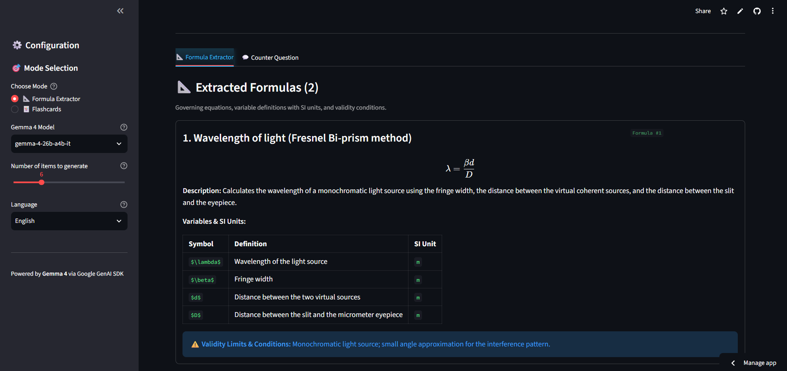
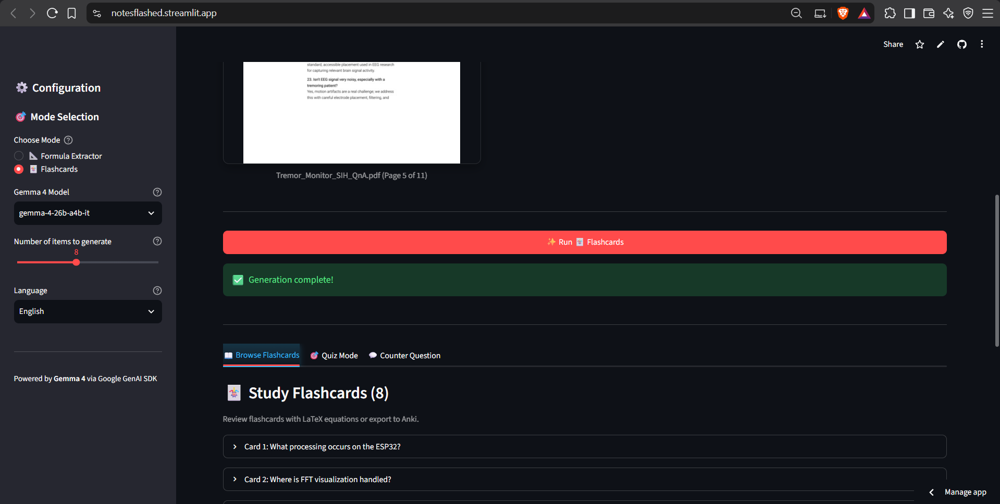
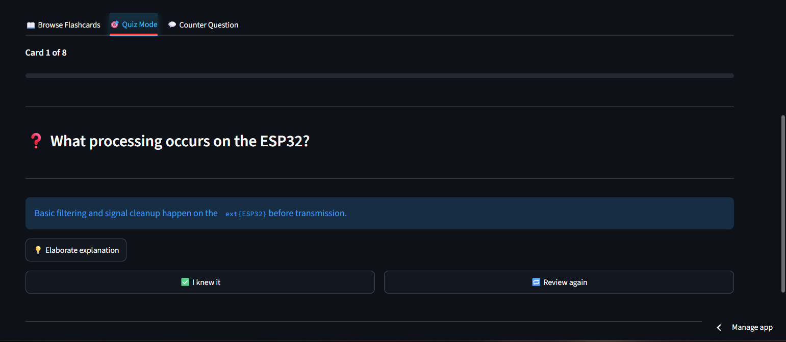
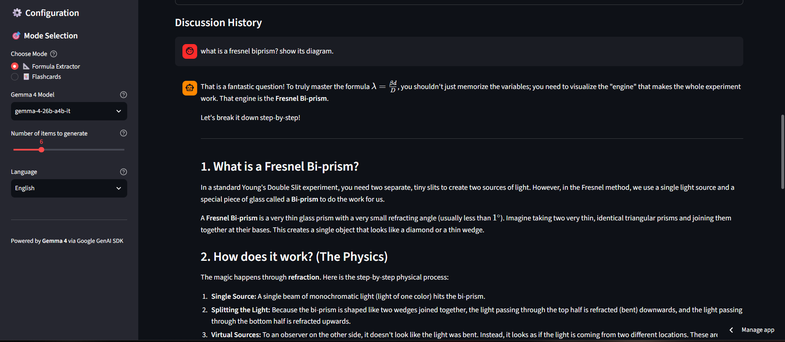

# ⚛️ STEM Formula Extractor & Flashcards

> **Hacktoberfest Hack Day · OpenSTEM Track**  
> _Extract governing formulas, SI units, and validity assumptions, or generate study flashcards with interactive quizzes and conceptual Q&A from your STEM notes._

---

## 🌟 Overview

An educational workstation built exclusively with **Gemma 4** open-weight models. It combines rigorous formula extraction with spaced-repetition flashcards:
1. **📐 Formula Extractor**: Extracts governing mathematical equations, variable definitions with standard SI units, and core validity conditions/assumptions.
2. **📖 Browse Flashcards**: Structured flashcards formatted with LaTeX mathematical equations, with one-click Anki CSV export and on-demand deep dives.
3. **🎯 Quiz Mode**: Interactive flashcard testing with answer reveal, score tracking, and retention reviews.
4. **💬 Counter-Question & Q&A**: Socratic conceptual dialogue allowing users to challenge or query any extracted formula or flashcard.

Supports both **local execution** (via `.env`) and **Streamlit Community Cloud** (via `st.secrets`).

---

## 📸 Screenshots

| 📐 Formula Extractor | 🃏 Study Flashcards |
|:---:|:---:|
|  |  |

| 🎯 Quiz Mode | 💬 Counter-Question & Q&A |
|:---:|:---:|
|  |  |

> _To add or update your screenshots, save your images in the `screenshots/` directory with these filenames:_
> - `screenshots/formula_extractor.png`
> - `screenshots/flashcards.png`
> - `screenshots/quiz_mode.png`
> - `screenshots/counter_question.png`

---

## 🚀 Features

### 1. 📐 Formula Extractor
- Extracts mathematical laws, physics equations, and chemical relationships.
- Formats equations cleanly using valid LaTeX (`st.latex()`).
- Generates a structured table of variable symbols, definitions, and SI units.
- Explicitly lists critical validity limits and assumptions (e.g., ideal gases, non-relativistic speeds, constant acceleration).

### 2. 📖 Flashcards & Anki Export
- Generates study flashcards from your notes with inline and block LaTeX equations.
- On-demand "💡 Elaborate explanation" for any card.
- Export directly to Anki-compatible `.csv` format for spaced-repetition study.

### 3. 🎯 Interactive Quiz Mode
- Card-by-card quizzing with progress bar and score percentage.
- Reveal answers, self-grade with "✅ I knew it" or "🔁 Review again", and get feedback.

### 4. 💬 Conceptual Counter-Question & Socratic Q&A
- Select any synthesized flashcard or extracted formula to challenge assumptions, explore edge cases, or ask for derivations from Gemma 4.

### 5. 📥 Clean Multi-Format Input
- **Image & PDF Upload**: Upload photos of handwritten notes or textbook pages (with 90° clockwise rotation and multi-page PDF page selection).
- **Text Area**: Paste raw equations, derivations, or lecture notes directly.

---

## 🧠 Supported Models (Gemma 4 Only)

- **`gemma-4-26b-a4b-it` (Default)**: Fast Mixture-of-Experts (4B active parameters per token).
- **`gemma-4-31b-it` (Fallback)**: High-capacity dense 31B parameter model.

---

## 💻 Quickstart

### Running Locally

1. **Setup Virtual Environment & Dependencies**:
   ```bash
   python -m venv .venv

   # Windows (PowerShell):
   .venv\Scripts\Activate.ps1

   # macOS / Linux:
   source .venv/bin/activate

   pip install -r requirements.txt
   ```

2. **Configure API Key**:
   Create a `.env` file in the project root:
   ```env
   GEMINI_API_KEY=your_gemini_api_key
   ```

3. **Start the App**:
   ```bash
   streamlit run app.py
   ```
   Open **[http://localhost:8501](http://localhost:8501)** in your browser.

### Deploying to Streamlit Community Cloud

1. Fork or push this repository to GitHub.
2. Go to [share.streamlit.io](https://share.streamlit.io/) and deploy your repo (`app.py`).
3. In your Streamlit app dashboard, open **Settings → Secrets** and add:
   ```toml
   GEMINI_API_KEY = "your_actual_api_key_here"
   ```

---

## 🧪 Testing

```bash
python -m pytest tests/test_cards.py -v
```
All 82 unit tests run completely offline with mocked API responses.

---

## 📁 Repository Structure

```
├── app.py               # Streamlit application UI & Gemma 4 fallback engine
├── cards.py             # Pure core logic: LaTeX prompt builders, parsers, and image helpers
├── requirements.txt     # Python dependencies
├── .env                 # Local API key storage (gitignored)
├── .gitignore           # Ignores .env, .venv, bytecode, and temporary files
├── README.md            # Documentation and setup instructions
├── screenshots/         # Application preview screenshots
│   ├── formula_extractor.png
│   ├── flashcards.png
│   ├── quiz_mode.png
│   └── counter_question.png
└── tests/
    ├── test_cards.py    # Pytest test suite (82 tests)
    └── create_sample.py # Test image utility
```
